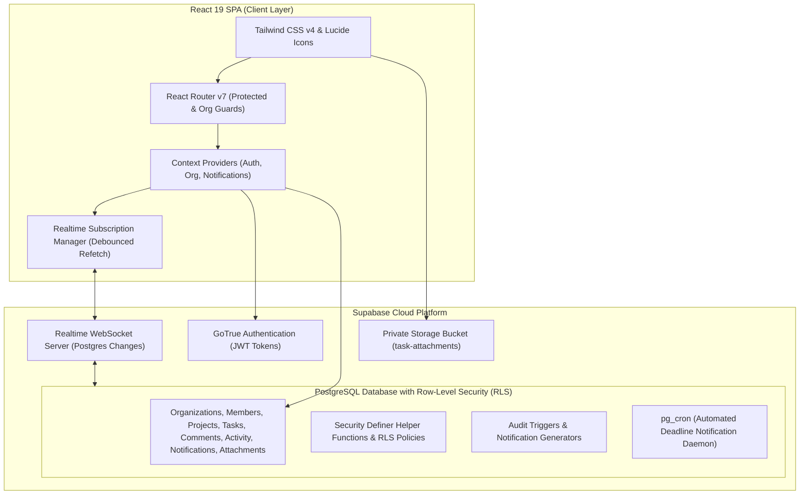

# ProjectFlow

ProjectFlow is a collaborative, multi-tenant project and task management platform engineered for strict data isolation, real-time collaboration, and actionable team reporting. Built with React 19, TypeScript, and Tailwind CSS v4, backed by Supabase PostgreSQL with Row-Level Security (RLS).

---

## Features

- **Multi-Tenant Organization Workspaces**: Strict database-level isolation. Users can create, switch between, and manage multiple team workspaces.
- **Role-Based Access Control (RBAC)**: Distinct permissions for `owner`, `manager`, and `member` roles across workspace settings, project creation, task management, and file uploads.
- **Dual-View Task Management**:
  - **Kanban Board**: Drag-and-drop workflow across To Do, In Progress, In Review, and Done columns with responsive cards.
  - **Task List View**: Sortable and filterable table supporting search, priority, assignee, status, and overdue filters.
  - **Per-Project Preference Memory**: Locally remembers selected view (Board vs List) per project.
- **Task Slide-Over Drawer**:
  - Comprehensive task editing with optimistic updates.
  - **Form Conflict Protection**: Preserves active, unsaved user edits if a task updates remotely in the background.
  - **Discussion Thread**: Rich task comments with relative timestamps and author badges.
  - **Immutable Activity Audit Log**: Detailed chronological ledger tracking task creation, status transitions, assignment changes, and file uploads.
  - **Private File Attachments**: Private file storage supporting PDFs, images, text, and Word documents with 60-second time-limited signed download URLs.
- **Notification Center**:
  - In-app notification bell with live badge counters.
  - Instant alerts for task assignments and discussion mentions.
  - **Automated Deadline Notifications**: Daily automated `due_soon` (due tomorrow) and `overdue` notifications with deterministic deduplication keys.
- **Organization-Scoped Reporting Dashboard**:
  - Metric summary cards: Active Projects, Active Tasks, Tasks Completed in Period, Overdue Count.
  - Efficiency metrics: Task Completion Rate, On-Time Completion Rate, Assignment Coverage, Notification Read Rate.
  - Date range filters: 7 Days, 30 Days, All Time.
  - Visual breakdown: Project Progress Bars, Task Status Distribution, and Team Workload Allocation.
- **Scoped Realtime Synchronization**:
  - WebSocket Postgres Changes subscribed exclusively to tenant-scoped channels (`recipient_id=eq...`, `project_id=eq...`, `task_id=eq...`, `organization_id=eq...`).
  - WAL `REPLICA IDENTITY FULL` ensuring update and delete row integrity.
  - Debounced authoritative refetch pattern preventing state drift.
  - Graceful degradation with visual connection indicators.

---

## Technology Stack

- **Frontend Framework**: React 19 (`react`, `react-dom`)
- **Language**: TypeScript (`~7.0.2`, strict type checking)
- **Routing**: React Router v7 (`react-router-dom`)
- **Styling**: Tailwind CSS v4 (`@tailwindcss/vite`, modern utility classes)
- **Icons**: Lucide React (`lucide-react`)
- **Drag and Drop**: `@hello-pangea/dnd`
- **Build Tool**: Vite 8 (`vite`, `@vitejs/plugin-react`)
- **Linting**: Oxlint (`oxlint`, fast Rust-powered linter)
- **Unit & Component Testing**: Vitest 5 (`vitest`, `jsdom`, `@testing-library/react`, `@testing-library/jest-dom`)
- **Code Coverage**: `@vitest/coverage-v8`
- **End-to-End Testing**: Playwright (`@playwright/test`)
- **Backend & Database**: Supabase (PostgreSQL with Row-Level Security, GoTrue Auth, Realtime Postgres Changes, Private Storage, `pg_cron`)

---

## Architecture Overview



For complete technical specifications, see [docs/ARCHITECTURE.md](docs/ARCHITECTURE.md).

---

## Local Setup Instructions

### 1. Clone & Install Dependencies

```bash
git clone <repository-url>
cd projectflow
npm install
```

### 2. Configure Environment Variables

Create a local `.env` file from the example template:

```bash
cp .env.example .env
```

Edit `.env` and fill in your Supabase project credentials:

```env
VITE_SUPABASE_URL=https://your-project-id.supabase.co
VITE_SUPABASE_PUBLISHABLE_KEY=your-supabase-publishable-key-here
```

### 3. Run Database Migrations

Apply the migration scripts located in `supabase/migrations/` in order using the Supabase SQL Editor or Supabase CLI:

1. `20261028_initial_projectflow_schema.sql`
2. `20261028_task_comments_and_activity.sql`
3. `20261028_in_app_notifications.sql`
4. `20261028_automated_deadline_notifications.sql`
5. `20261028_task_file_attachments.sql`
6. `20261028_enable_realtime_sync.sql`

### 4. Configure Supabase Dashboard

1. **Storage**: Confirm the bucket `task-attachments` is set to private (`public = false`) with 10MB maximum file size.
2. **Realtime**: Ensure Realtime is enabled under **Database** → **Replication** with the 5 tables registered in `supabase_realtime`.
3. **Automated Deadlines (Optional)**: Enable `pg_cron` extension and schedule `public.generate_deadline_notifications()`. See [docs/DEPLOYMENT.md](docs/DEPLOYMENT.md).

### 5. Start Development Server

```bash
npm run dev
```

Open `http://localhost:5173` in your browser.

---

## Automated Test Commands

ProjectFlow includes a comprehensive automated test stack:

```bash
# Run unit and component test suite
npm run test

# Run tests in watch mode
npm run test:watch

# Run tests with V8 code coverage report
npm run test:coverage

# Run Playwright end-to-end journey
npm run test:e2e
```

### Test Coverage Highlights
- **Utility Tests**: Overdue task calculation, due tomorrow calculation, date formatting, task sorting by priority/due date/created date, dashboard metrics (completion rates, on-time rates, assignment coverage, notification read rates), project progress calculation.
- **Component Tests**: Route guards (`ProtectedRoute`, `RequireOrganization`), role-based UI access in `ProjectsPage`, empty & error states with retry, notification center counter & mark-all-as-read workflows.
- **E2E Journey**: Complete user journey covering sign-in, workspace onboarding, project creation, task creation, status transition to Done, task comments, and notification center verification.

---

## Security Review & Checklist

- [x] **Zero Service-Role Key Exposure**: Client application, environment variables, tests, and documentation use only the public anon key. The database enforces all policies via PostgreSQL RLS.
- [x] **Private File Storage**: File attachments are stored in a private bucket. Files are accessed strictly via 60-second time-limited signed URLs generated on-demand.
- [x] **Environment Secrets Ignored**: `.env` and `.env.*` are explicitly excluded from Git tracking in `.gitignore`.
- [x] **Multi-Tenant Boundary Isolation**: Tenant isolation functions (`is_org_member`, `can_access_project`, `can_access_task`) use `SECURITY DEFINER` with search path restrictions to prevent RLS bypass or recursion.
- [x] **Scoped Realtime Subscriptions**: No open schema listeners. Subscriptions use row filters (`project_id=eq...`, `recipient_id=eq...`, `task_id=eq...`, `organization_id=eq...`).
- [x] **Form Collision Protection**: Task Drawer inspects form dirty state to preserve in-progress typing during background remote updates.

---

## Deployment Preparation

- **SPA Rewrites**: `vercel.json` and `public/_redirects` are included to support deep-linking (`/dashboard`, `/projects/:projectId`, task query params) on static hosts.
- **Production Build**: Verified with `npm run build` (`tsc -b && vite build`) generating an optimized production bundle in `dist/`.
- Detailed deployment instructions are documented in [docs/DEPLOYMENT.md](docs/DEPLOYMENT.md).

---

## Known Limitations & Honest Disclosure

1. **Email Delivery**: Notifications are currently delivered in-app. External email dispatch for deadlines requires configuring Supabase Edge Functions or an external SMTP provider (e.g. Resend / SendGrid).
2. **Offline Mode**: Realtime collaboration relies on an active WebSocket connection. While cached UI states and optimistic updates function during transient network blips, full offline persistence with local queue reconciliation is not implemented.
3. **E2E CI Testing**: Playwright E2E tests require dedicated test user credentials in a local or staging Supabase project; if credentials are not provided in environment variables, the test cleanly skips rather than running against production data.

---

## Screenshots

<!-- Screenshot Placeholders (Do not remove) -->
| View | Preview |
| :--- | :--- |
| **Reporting Dashboard** | *(Screenshot Placeholder: Organization Metrics & Progress)* |
| **Kanban Board** | *(Screenshot Placeholder: Multi-column Drag-and-Drop Board)* |
| **Task Drawer & Attachments** | *(Screenshot Placeholder: Comments, Activity Timeline, & File Uploads)* |
| **Notification Center** | *(Screenshot Placeholder: Realtime In-App Notification Feed)* |

---

## Documentation Links

- [System Architecture](docs/ARCHITECTURE.md)
- [Demonstration Script & Guide](docs/DEMO_GUIDE.md)
- [Production Deployment Guide](docs/DEPLOYMENT.md)
