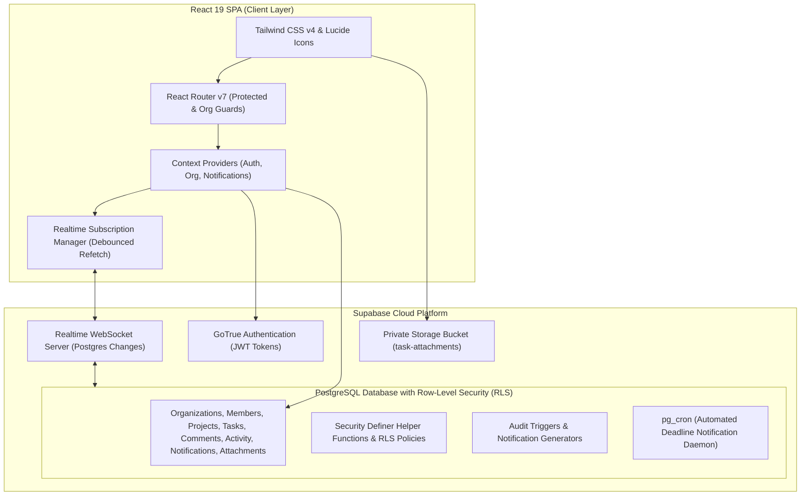
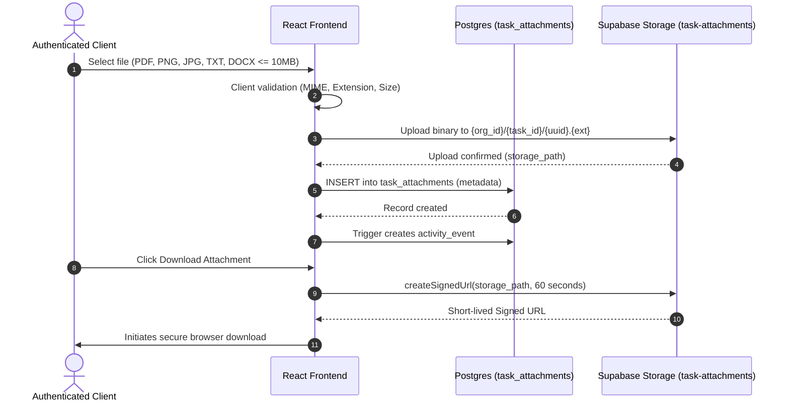
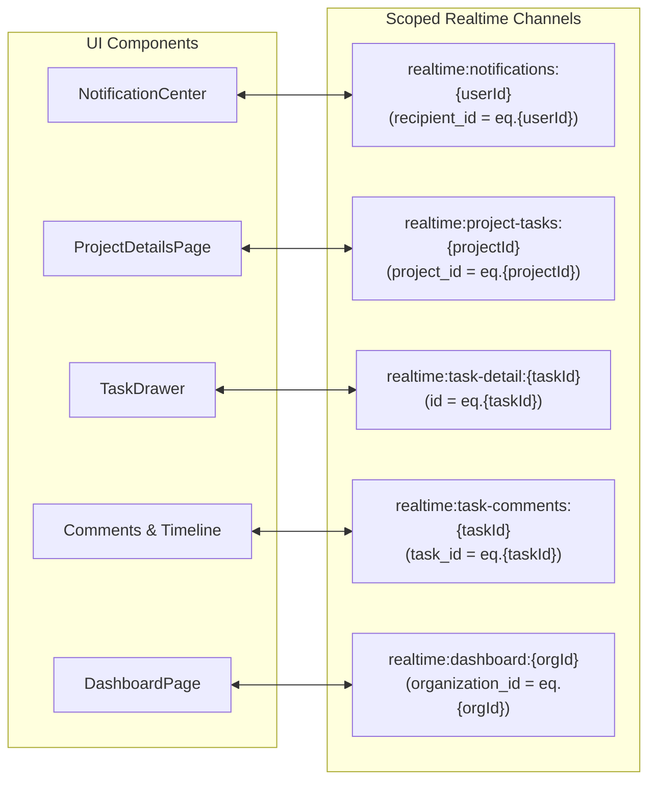

# ProjectFlow System Architecture

ProjectFlow is a collaborative, multi-tenant project and task management platform engineered for strict data isolation, real-time collaboration, and actionable team reporting. It couples a React 19 single-page application with a secure Supabase backend (PostgreSQL, Row-Level Security, GoTrue Auth, Realtime Postgres Changes, and Storage).

---

## 1. High-Level System Architecture

---

## 2. Multi-Tenant Organization Isolation & Security Strategy

ProjectFlow enforces multi-tenant boundary isolation at the database engine level via PostgreSQL Row-Level Security (RLS). No client query can read or mutate records belonging to an organization where the authenticated user is not an active member.

### Organization Membership & Roles
Organizations contain members with one of three roles:
1. **`owner`**: Full administrative authority; manage workspace settings, invite members, create/edit/delete any project or task.
2. **`manager`**: Operational management; create/edit/delete projects and tasks, assign members, upload files.
3. **`member`**: Team contributor; view assigned projects and tasks, modify assigned task status, submit comments, and upload attachments to accessible tasks.

### Security Definer Helper Functions
To avoid recursive subqueries and ensure high performance without bypassing security checks, PostgreSQL `SECURITY DEFINER` functions evaluate permissions:
- `public.is_org_member(org_id UUID)`: Verifies if `auth.uid()` belongs to the specified organization.
- `public.get_org_role(org_id UUID)`: Returns the caller's role (`owner`, `manager`, `member`).
- `public.can_access_project(proj_id UUID)`: Validates that the project belongs to an organization where the user is an active member.
- `public.can_access_task(task_id UUID)`: Validates organization boundary for task operations.

### RLS Policies Matrix
| Table | SELECT | INSERT | UPDATE | DELETE |
| :--- | :--- | :--- | :--- | :--- |
| `organizations` | Org members only | Authenticated users (creator becomes owner) | Owners only | Owners only |
| `organization_members` | Org members only | Owners & Managers | Owners only | Owners (cannot remove last owner) |
| `projects` | Org members only | Owners & Managers | Owners & Managers | Owners & Managers |
| `tasks` | Org members only | Owners & Managers | Owners, Managers, or Assignee | Owners & Managers |
| `comments` | Org members only | Org members | Comment Author only | Comment Author, Owner, or Manager |
| `activity_events` | Org members only | Triggers & Org members | Disallowed (append-only ledger) | Disallowed (append-only ledger) |
| `notifications` | Recipient only (`recipient_id = auth.uid()`) | System triggers & Org members | Recipient only (`read_at` timestamps) | Recipient only |
| `task_attachments` | Org members with project access | Org members with task access | Disallowed (immutable metadata) | Attachment Uploader, Owner, or Manager |

---

## 3. Storage Architecture: Private File Attachments

Task file attachments are managed using Supabase Storage paired with database metadata records in `public.task_attachments`.

### Key Attachment Security Rules
1. **Private Bucket**: The `task-attachments` bucket has `public = false`. Public URLs are never generated.
2. **Deterministic Private Path**: Files are keyed under `{organization_id}/{task_id}/{file_uuid}.{ext}`.
3. **Storage RLS Policies**: Storage objects inherit tenant isolation—a user can only upload or read files where their JWT belongs to the matching `{organization_id}` folder.
4. **Time-Limited Signed URLs**: Downloads request a 60-second authenticated pre-signed URL from Supabase Storage.

---

## 4. Realtime Synchronization Architecture

ProjectFlow implements scoped Realtime updates using Supabase Realtime Postgres Changes without public broadcast channels or unfiltered schema streams.

### WAL Replica Identity Full
To allow column-equality filters (such as `project_id=eq...` or `task_id=eq...`) on `UPDATE` and `DELETE` events, PostgreSQL sets `REPLICA IDENTITY FULL` on all enabled tables. Without this, Postgres WAL streams only transmit the primary key on deletes, causing scoped filters to drop delete notifications.

### Debounced Authoritative Refetching
Client components avoid fragile optimistic state reconstruction by using a 250ms–350ms debounce utility (`createDebounce`). Multiple incoming WebSocket notifications within a short window trigger a single authoritative database query.

### Conflict Protection in Task Drawer
When editing a task while a remote update arrives:
- **Form Unmodified (`!isDirty`)**: Form fields automatically update to reflect the remote change.
- **Form Modified (`isDirty`)**: The user's in-progress changes are preserved, and a non-intrusive banner alerts the user: *"Remote update detected. Your active unsaved edits are preserved."*

---

## 5. Notification & Automated Deadline Alert Flow

Notifications alert users to assignments, discussions, and impending or past deadlines.

### Notification Generation Paths
1. **Instant Triggers**:
   - `task_assigned`: Triggered on `tasks.assignee_id` change.
   - `comment_added`: Triggered on `comments` insertion for all project members participating in the task.
2. **Automated Deadline Daemon (`pg_cron`)**:
   - `generate_deadline_notifications()` runs every morning (e.g. `0 6 * * *`).
   - Identifies active non-done/non-cancelled tasks due tomorrow (`due_soon`).
   - Identifies active non-done/non-cancelled tasks past due date (`overdue`).
   - Uses deterministic `dedupe_key` (`due_soon:{task_id}:{due_date}` and `overdue:{task_id}:{current_date}`) with `ON CONFLICT (dedupe_key) DO NOTHING` to guarantee zero duplicate alerts.

